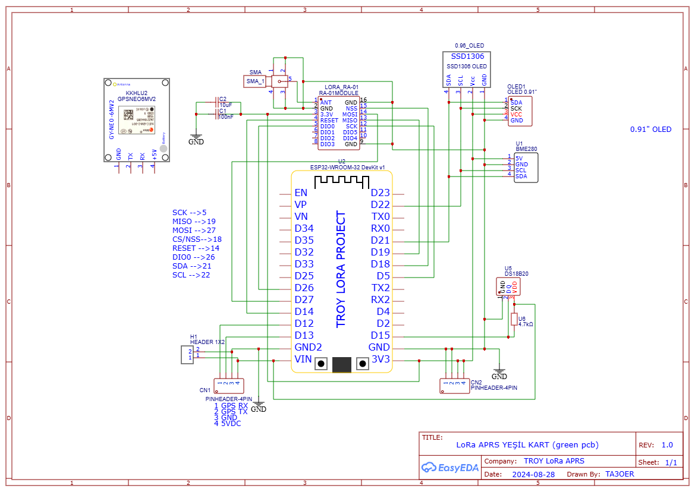

# TROY LoRa DigiRepeater

ESP32 + SX127x tabanlı **LoRa APRS fill-in digipeater**. 433.775 MHz'de dinler, yolunda `WIDE1-1` bulunan paketleri `ÇAĞRI*` ile yeniden yayınlar. Ayarlar ve firmware güncellemesi cihazın kendi WiFi arayüzünden yapılır.

> **English summary:** A LoRa APRS fill-in digipeater for ESP32 + SX127x (433.775 MHz). It repeats packets whose path contains `WIDE1-1`, with a randomized non-blocking delay to avoid collisions. Includes a built-in web UI (config, live log, OTA update), NVS-persisted settings and duplicate suppression. Documentation is in Turkish; see [`docs/help.html`](docs/help.html) for the full code guide.

**Durum:** v1.0.2, saha testleri sürüyor.
**Geliştirici:** TA3OER

---

## Özellikler

- **Fill-in digipeat:** yalnızca `WIDE1-1` işlenir (WIDE2-x vb. yok sayılır). Yol yeniden yazılır: `WIDE1-1` → `ÇAĞRI*`.
- **Çarpışma önleme:** digipeat öncesi 300–1200 ms rastgele bekleme. Bekleme **bloklamaz** (tek slotlu kuyruk), bu yüzden bekleme sırasında alım kesilmez.
- **Kopya engelleme:** 8 kayıtlık halka, 30 sn pencere.
- **Filtreler:** `NOGATE` / `TCPIP` içeren paketler ve kendi paketlerimiz aktarılmaz; yolunda `ÇAĞRI*` olan paket tekrar yayınlanmaz.
- **Beacon:** açılışta ve periyodik olarak konum+yorum ve durum paketi (sayaç dahil).
- **Web arayüzü** (WiFi AP): kullanıcı ayarları, LoRa parametreleri, canlı LOG, OTA.
- **Kalıcı ayarlar:** NVS (`Preferences`); OTA güncellemesi ayarları silmez.
- **Sunucu tarafı doğrulama:** çağrı işareti, koordinat ve LoRa parametreleri kaydedilmeden önce denetlenir; geçersiz girişte hiçbir şey uygulanmaz.
- **OTA:** web üzerinden `firmware.bin` yükleme (iki OTA bölümü).
- **Seri komutlar** ile WiFi aç/kapa.

## Donanım

| | |
|---|---|
| Kart | ESP32 DOIT DevKit V1 (`platformio.ini`'deki ortam) |
| Radyo | SX127x tabanlı LoRa modülü (433 MHz) |
| Flash | 4 MB (bölüm tablosu `partitions.csv`) |

### Pinler

| Sinyal | GPIO |
|---|---|
| LoRa SCK | 5 |
| LoRa MISO | 19 |
| LoRa MOSI | 27 |
| LoRa SS (NSS) | 18 |
| LoRa RST | 14 |
| LoRa DIO0 | 26 |
| LED | 2 |
| WiFi düğmesi (BOOT) | 0 |

Farklı bir kart kullanıyorsanız `src/main.cpp` içindeki pin `#define` satırlarını değiştirmeniz yeterlidir.

### Bağlantı şeması




> **Uyarı:** Modülü **anten takılı değilken asla yayın yaptırmayın**. İlk denemelerde gücü düşük (örn. 15 dBm) tutun.

## Derleme ve yükleme

[PlatformIO](https://platformio.org/) gerekir.

```bash
pio run                 # derle
pio run -t upload       # USB ile yükle
pio device monitor      # seri monitör (115200)
```

Kütüphane: [`sandeepmistry/LoRa`](https://github.com/sandeepmistry/arduino-LoRa) (`platformio.ini` içinde tanımlı, otomatik inşa edilir).

OTA'nın çalışması için `partitions.csv` kullanılır: iki adet ~1.94 MB uygulama bölümü (`app0`, `app1`), 16 KB NVS, 64 KB SPIFFS.

## İlk kullanım

1. Cihaza gücü verin. Açılışta seri monitörde ve LOG'da `LoRa hazir: 433.775 MHz SF12 ...` satırını görmelisiniz.
2. WiFi varsayılan olarak **kapalıdır**. BOOT düğmesini **3 saniye** basılı tutun (veya seri monitörden `wifi on` yazın).
3. `TROY-DigiRepeater` ağına bağlanın (varsayılan şifre `12345678`).
4. Tarayıcıda `http://192.168.4.1` adresini açın.
5. **Kullanıcı** sekmesinden çağrı işaretinizi ve konumunuzu girin, **LoRa** sekmesinde sync word'ü çevredeki istasyonlarla eşleştirin.
6. İşiniz bitince WiFi'yi tekrar 3 sn basılı tutarak kapatın.

### Varsayılan değerler

| Ayar | Varsayılan |
|---|---|
| Çağrı işareti | `TR0Y-5` |
| Frekans | 433.775 MHz |
| SF / BW / CR | 12 / 125 kHz / 4/5 |
| TX gücü | 15 dBm |
| Sync word | `0x12` |

> **Sync word:** Çevredeki LoRa APRS istasyonları çoğunlukla `0x34` kullanır. Sync word eşleşmezse birbirinizi duymazsınız. Sahaya çıkmadan karşı istasyonlarla doğrulayın.
>
> **Varsayılanlar yalnızca NVS boşken geçerlidir.** Bir kez web'den kayıt yapıldıysa, koddaki varsayılanı değiştirmek etkisiz kalır; ayarı web arayüzünden değiştirin.

## Nasıl çalışır?

```
Gelen : TA3OER-7>APLRT1,WIDE1-1:!4018.59N/02614.10E>test
Giden : TA3OER-7>APLRT1,TR0Y-5*:!4018.59N/02614.10E>test
```

1. Paket alınır, `WIDE1-1` yalnızca **yol** kısmında aranır.
2. Kopya, kendi paketi, `NOGATE`/`TCPIP` ve "zaten bizden geçmiş" kontrolleri yapılır.
3. Yol yeniden yazılır ve paket **tek slotlu kuyruğa** alınır.
4. `loop()` çalışmaya devam ederken rastgele süre dolunca paket yayınlanır.

Ayrıntılı açıklama (her fonksiyon, kuyruk mantığı, RX kaybının nedeni ve çözümü) için bkz. **[docs/help.html](docs/help.html)**.

### Yardım dosyasını görüntüleme

GitHub, `.html` dosyalarını sayfa olarak göstermez. İki seçenek:

- Repoyu indirip `docs/help.html` dosyasını tarayıcıda açın, veya
- **GitHub Pages**'i açın: *Settings → Pages → Branch: `main`, klasör: `/docs`*. Sayfa birkaç dakika sonra `https://<kullanıcı>.github.io/<depo>/help.html` adresinde yayınlanır.

## Seri komutlar

115200 baud, satır sonu Newline.

| Komut | Etki |
|---|---|
| `wifi on` / `wifi ac` | WiFi AP'yi aç |
| `wifi off` / `wifi kapat` | WiFi'yi kapat |
| `wifi` | Durumu göster |
| `help` / `?` | Komut listesi |

## OTA güncelleme

1. WiFi'yi açın, **OTA** sekmesine gelin.
2. Yalnızca `.pio/build/esp32doit-devkit-v1/firmware.bin` dosyasını seçin.
3. Yükleme sürerken gücü kesmeyin; cihaz bu sırada alım ve digipeat yapmaz. Bitince yeniden başlar (WiFi kapalı açılır).

> `bootloader.bin` veya birleştirilmiş imaj yüklemeyin; cihazı açılmaz hale getirebilir. Geri alma (rollback) yoktur, ilk OTA denemesini USB erişiminizin olduğu yerde yapın.

## Bilinen sınırlamalar ve güvenlik

- **TX sırasında alım kördür.** SF12'de bir paket ~2–4 sn sürer; yarı dupleks radyonun doğal sınırıdır.
- **AP şifresi koda gömülüdür** (`12345678`) ve ayar/OTA sayfalarında ek kimlik doğrulama yoktur. AP'ye bağlanan herkes ayarları değiştirebilir veya firmware yükleyebilir. Yayın ortamında şifreyi değiştirin ve WiFi'yi yalnızca gerektiğinde açın.
- `/restart` yetkisiz bir GET isteğiyle cihazı yeniden başlatır.
- OTA'da dosya adı denetimi büyük/küçük harfe duyarlıdır (`FIRMWARE.BIN` cihazda reddedilir).
- Tek slotlu kuyruk nedeniyle yoğun trafikte bazı paketler digipeat edilmeyebilir.
- Cihazda saat yoktur; beacon dakikaları açılıştan itibaren sayılır.

## Sürüm geçmişi

| Sürüm | Değişiklik |
|---|---|
| **1.0.2** | Digipeat beklemesi bloklamayan kuyruğa alındı; bekleme sırasındaki RX kaybı giderildi. Kopya kaydı yalnızca gerçek adayda ve kuyruk boşken yapılır. |
| 1.0.1 | Rastgele digipeat gecikmesi (bloklayan, RX kaybına yol açtı); yol ayrıştırma sağlamlaştırıldı. |
| 1.0.0 | İlk sürüm: web arayüzü, OTA, NVS, LOG, kopya engelleme. |

## Yasal not

Amatör telsiz istasyonu işletmek için geçerli bir lisans ve bulunduğunuz ülkenin frekans/güç düzenlemelerine uyum gerekir. Yazılım olduğu gibi, herhangi bir garanti vermeden sunulur.

---

73! — TA3OER
